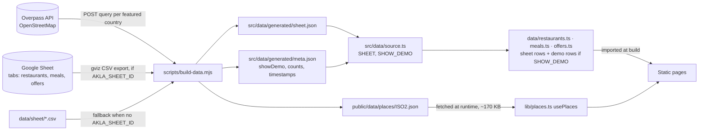

# Akla — Architecture

How the code is organised and how data gets from OpenStreetMap / the Google Sheet into a static site.
Start with [HANDOVER.md](../HANDOVER.md) if you haven't. Data *setup* (sheet columns, sharing) lives in [DATA.md](DATA.md);
this file covers how the code consumes it.

## 1. Stack

| Concern | Choice | Where |
|---|---|---|
| Framework | Next.js 16.4 App Router, React 19.3, TypeScript (strict) | `package.json`, `tsconfig.json` |
| Output | Static export (`output: "export"`) → `out/` → GitHub Pages | `next.config.ts`, `.github/workflows/deploy.yml` |
| Styling | Tailwind CSS 4 (CSS-first `@theme` tokens, via `@tailwindcss/turbopack` loader) | `src/app/globals.css`, `next.config.ts` |
| State | Zustand 5 with `persist` (localStorage key `akla`) | `src/lib/store.ts` |
| Animation | `motion` (Framer Motion successor), `canvas-confetti`, WebAudio blips | `src/lib/fx.ts` |
| Maps | Leaflet 1.9 + OpenStreetMap tiles | `src/components/MapView.tsx` |
| Icons | `lucide-react` | |
| Fonts | `next/font/google`: Baloo Bhaijaan 2 (display), Rubik (body) | `src/app/layout.tsx` |

There is **no backend, no API route, no database, no auth**. Everything runs in the browser; user data stays on the device.

## 2. Folder layout

```
scripts/build-data.mjs    build-time data builder (OSM + Google Sheet → JSON)
data/sheet/*.csv          Google Sheet templates; also the local fallback data source
public/data/places/*.json OSM snapshot per featured country, e.g. KW.json (generated, committed, fetched at runtime)
src/
  app/                    routes — thin server components: metadata + render one View
  views/                  one client component per page ("use client"), incl. views/games/*
  components/             shared UI: ui.tsx (design system), cards.tsx, Wheel, MapView, QueryParam, Providers
    shell/                Header, BottomNav, Footer, SearchOverlay, LocationPicker
  data/                   demo content + static reference data (categories, governorates/areas)
    generated/            sheet.json + meta.json (generated, committed, imported at build time)
    source.ts             reads generated/*, decides SHOW_DEMO
  lib/                    logic with no JSX: store, i18n, messages, time, openingHours, recommend, search, geo, places, fx, hooks, types
```

### Routes → views

Every `src/app/**/page.tsx` is ~8 lines: export `metadata`, render a View. Example: `src/app/offers/page.tsx` → `OffersView`.

| Route | View | Notes |
|---|---|---|
| `/` | `views/HomeView.tsx` | |
| `/picker/` | `views/PickerView.tsx` | uses `components/Wheel.tsx` |
| `/offers/` | `views/OffersView.tsx` | |
| `/restaurants/` | `views/RestaurantsView.tsx` | `?tab=all` switches to the OSM directory (`components/RealPlacesDirectory.tsx`) |
| `/restaurants/[id]/` | `views/RestaurantView.tsx` | statically generated, see §3 |
| `/place/?id=n123` | `views/PlaceView.tsx` | OSM place page, id read from the query string |
| `/nearby/` | `views/NearbyView.tsx` | map + list |
| `/discover/` | `views/DiscoverView.tsx` | `?c=<category>` preselects a category; `#budget` anchors the budget planner |
| `/favorites/`, `/trending/`, `/compare/`, `/profile/` | matching `*View.tsx` | |
| `/games/`, `/games/{battle,mystery,challenges,group}/` | `views/games/*View.tsx` | Group shares its shortlist in the URL hash `#o=…` |

`src/app/layout.tsx` wraps every page in `Providers` → `Header`, `<main>`, `Footer`, `BottomNav`.
`src/app/not-found.tsx` is a client component so it can be translated.

## 3. Static-export constraints

The site is plain files on GitHub Pages, so:

- **`output: "export"`** (`next.config.ts`) — no server at runtime. No API routes, no middleware, no ISR, no `cookies()`/`headers()`.
  Anything that depends on the request (location, time, language) is computed in the browser.
- **`trailingSlash: true`** — every route is emitted as `route/index.html`. Internal links are written with the trailing
  slash (`/restaurants/`, `/games/challenges/`; see `components/shell/Header.tsx`).
- **`basePath`** — set from `NEXT_PUBLIC_BASE_PATH` (the workflow uses `/<repo-name>`; empty locally). `next/link` and
  assets get it automatically, but **raw `fetch` / URLs don't**: prefix them with `BASE_PATH` from `src/lib/img.ts`
  (as `src/lib/places.ts` does for `/data/places/<ISO2>.json`).
- **`images: { unoptimized: true }`** — no image optimisation server. Food photos are TheMealDB URLs built by `mdb()` /
  `sized()` in `src/lib/img.ts` and rendered via `FoodImage` in `components/ui.tsx`.
- **Dynamic segments need `generateStaticParams`**. `src/app/restaurants/[id]/page.tsx` sets `dynamicParams = false`
  and returns one param per entry in `RESTAURANTS`. If there are none (sheet empty *and* `AKLA_SHOW_DEMO=never`) it
  returns a placeholder `{ id: "_" }`, because an export needs at least one path; that page calls `notFound()`.
  Consequence: **a new sheet restaurant only gets a page after a rebuild.**
- **Unbounded ids use query params instead of segments.** There are ~1,600 OSM places, so they are not pre-rendered:
  `/place/?id=n123` is one static page that reads the id on the client. `components/QueryParam.tsx` wraps
  `useSearchParams()` in `<Suspense>` so the rest of the page still prerenders. Use it for any new query param.
- **Hydration safety.** The HTML is built once, so the first client render must match it. Patterns used:
  - `useNow()` / `useMounted()` in `src/lib/hooks.ts` return `null`/`false` until mounted; time-dependent UI waits for them.
  - `useOffers()` buckets offers with `preMountStatus()` (`src/data/offers.ts`) before mount, then by the live clock.
  - The store uses `skipHydration: true`; `Providers` calls `useStore.persist.rehydrate()` after mount.
  - An inline `boot` script in `layout.tsx` sets `<html lang/dir>` and `data-motion` from localStorage before paint
    (hence `suppressHydrationWarning` on `<html>`).
- **Browser-only libraries** (Leaflet) are loaded with `next/dynamic(..., { ssr: false })` in the views and
  `import("leaflet")` inside an effect in `MapView.tsx`.

## 4. Data pipeline



### `scripts/build-data.mjs`

Runs as `npm run data`, as the `prebuild` hook of `npm run build`, and as its own step in the workflow.
Flags: `--skip-osm`, `--force-osm` (`npm run data:refresh`). Env: `AKLA_SHEET_ID`, `AKLA_SHOW_DEMO`, `AKLA_SHEET_DIR`
(overrides `data/sheet/`), `CI`.

1. **OSM** — one Overpass query per featured country (`AKLA_COUNTRIES`, default `KW,SA,AE,QA,BH,OM`) for named `amenity=restaurant|fast_food|cafe|ice_cream|food_court`, tried
   against two mirrors. Elements are compacted to short keys (`i` id, `n` name, `y`/`x` lat/lng, `t` kind, `c` cuisine,
   `h` hours, `p` phone, `w` website, …) and written to `public/data/places/<ISO2>.json`.
   - Re-fetched when `CI` is set, when `--force-osm` is passed, or when the snapshot is missing or older than 12 h.
   - If Overpass fails or returns fewer than 50 places, the previous snapshot is kept.
2. **Sheet** — reads the three tabs from Google (`/gviz/tq?tqx=out:csv`) or from the local CSVs. Keeps only
   `status = published` rows, validates them (category ids, restaurant references, dates parsed in the restaurant's time zone, `country`/`currency`/`timezone` defaulting to Kuwait),
   fills missing location/hours/phone/website from the referenced `osm_id`, and writes `sheet.json`.
   Invalid rows are skipped with a `[data] ⚠` warning. On a sheet download error in CI, the previous `sheet.json` is kept.
3. **Meta** — writes `meta.json` with `generatedAt`, `showDemo` (`auto`/`always`/`never`), OSM and sheet stats.

### Consuming it

- `src/data/source.ts` imports both generated JSON files. `SHOW_DEMO` is true when `showDemo === "always"`, or
  `"auto"` and the sheet has zero published restaurants.
- `src/data/restaurants.ts`, `meals.ts`, `offers.ts` export `RESTAURANTS`, `MEALS`, `buildOffers(now)` = sheet rows
  (tagged `source: "partner"`) followed by the fictional demo rows when `SHOW_DEMO`. Sheet restaurants get an `areaId`
  (nearest of `AREAS` in `src/data/geo.ts` if missing), parsed `hours`, a category cover image fallback, and their rating is
  dropped unless `ratingSource` is set.
- Demo offers are defined relative to "today" (`[dayOffset, "HH:MM"]`) and materialised against the Kuwait day of the
  current time, so they always look fresh.
- OSM places are **not** bundled: `usePlaces()` in `src/lib/places.ts` fetches `${BASE_PATH}/data/places/<country>.json` once per
  visit, decodes each place (cuisine → `CategoryId` via regex table, nearest area, emoji, parsed hours).

Trust model: demo = 🧪 badge, OSM = 🗺️ badge, community offers vs verified. See `DemoBadge` / `TrustBadge` in
`components/ui.tsx` and the trust section of [BRAND.md](BRAND.md).

## 5. State — `src/lib/store.ts`

One Zustand store, `useStore`, persisted to localStorage under `akla` (version 1). Holds: `locale`, `location`
(area or GPS), `motion` and `sound` preferences, `favorites` per kind, `collections`, view/offer/category history,
`spins`, `battlesWon`, `achievements` (id → unlock ISO time), `streak`, `challengesDone`. `toast` is transient
(excluded by `partialize`).

- Hydration is manual (`skipHydration: true`), triggered in `components/Providers.tsx`, which then calls
  `touchStreak(kuwaitDateKey(now))`.
- **Achievements**: `ACHIEVEMENTS` (id, emoji, colour, goal) plus `achievementProgress(state)`, which derives progress
  from the stored history. Every mutating action that can affect progress calls the internal `check()`, which stamps
  newly reached achievements and shows a toast `achievement:<id>`; `Providers`' `Toast` turns that into the translated
  title from `t.achievements[id]`.
- Selectors: `useStore((s) => s.x)`; `useFav(kind, id)` for favourite buttons.

## 6. i18n & RTL

- `src/lib/messages.ts` — `en` is the source object; `type Messages = typeof en`; `ar: Messages` must match it exactly
  (TypeScript enforces this). Values can be strings, tuples (achievements: `[title, description]`) or functions
  (`closesAt: (t) => …`). Some groups use `satisfies Record<Mood | MealTime | …, string>` so new union members fail to
  compile until translated.
- `src/lib/i18n.ts` — `useI18n()` returns `{ locale, t, l, dir, price, km, clock, date }`. `t` is the message tree;
  `l(x)` picks the locale from an `L = { ar, en }` object (used for all content data). Formatters: prices always 3
  decimals for KWD (`KWD 2.750` / `2.750 د.ك`), other currencies via `Intl.NumberFormat` in the selected country's currency; dates in the selected city's time zone with Latin digits.
- Direction: `<html dir>` is `rtl` for Arabic. It is set before paint by the `boot` script and kept in sync by
  `Providers`. Tailwind has a custom `rtl:` variant (`globals.css`), and layouts use logical utilities
  (`start-*`, `end-*`, `text-start`) so they flip automatically.
- Routes are not localised (no `/ar`, `/en`); language is a client preference.

## 7. Countries, time and currency

The user picks a **country** (ISO code, `country` in the store) and a location in it (curated area, searched city, or
GPS). Kuwait is the default, and settings saved before multi-country support (store v1) migrate to Kuwait.

- `src/data/generated/countries.json` (from `scripts/gen-countries.mjs`, IANA `zone.tab`): currency and time zones,
  each with a reference city, for 245 countries. Names come from `Intl.DisplayNames`. `src/lib/region.ts` wraps it:
  `defaultCity`, `timeZoneAt` (nearest zone city, exact for single-zone countries), `countryFromDeviceTz`,
  `speaksArabic` (the language follows the country until the user picks one), and `scaleBudget` (KWD budget presets
  → friendly local amounts).
- The store derives `region` = `{ country, timeZone, currency }` on every country/location change and mirrors it in
  `activeRegion()`, so pure helpers default to it. `useI18n()` exposes `region`, `price(n, currency?)`, `cur`, `amt`.
- **Featured countries** (`FEATURED_COUNTRIES` in `src/data/geo.ts`: the GCC six) have curated areas and a build-time
  OSM snapshot. **Everywhere else**, `usePlaces()` queries Overpass live: around the location, 2.5 km (8 km if
  < 25 hits), max 400 results, one request at a time, a second mirror, cached in localStorage per ~1 km cell for 24 h.
  City search and GPS → country use Nominatim (`src/lib/geocode.ts`): on submit only, ≥ 1.1 s apart, cached.
- Listings (sheet/demo restaurants, meals, offers) carry `country`, `currency`, `timeZone`; views read them through
  `useRestaurants()`, `useMeals()`, `useOffers()`, `useLive()` (`src/lib/hooks.ts`), which only return the selected
  country's. Countries with none get the "coming soon" cards and OSM places.

`src/lib/time.ts` works in any IANA zone with `Intl` (DST-safe): `localParts`, `localDayStart`, `localDateKey`
(streaks/daily challenges), `openState(hours, now, tz?)` (handles after-midnight closing from the previous day,
"closing soon" within 45 min), `mealTimeAt`, `countdownParts`, and `seeded()` — a deterministic PRNG so "daily"
content is the same for everyone on the same day. Listed restaurants use their own `timeZone`; OSM places the
selected city's.

`src/lib/openingHours.ts` parses the OSM `opening_hours` subset (`24/7`, `Mo-Su 10:00-23:00`, `Sa-Th …; Fr …`,
`Fr off`). Anything ambiguous returns `undefined`, shown as "hours not available" — the app never guesses.

## 8. Recommendation engine — `src/lib/recommend.ts`

`recommend(input, limit = 8)` scores every meal in `MEALS` (optionally capped by `maxPrice`) with additive,
explainable rules: mood match +6 (plus mood-specific bonuses), meal-time match +3, favourite restaurant/category +2
each, active offer +2, editor's pick +1, restaurant rating `(rating − 4) × 2`, distance penalty up to −4, plus a little
randomness (much more for the "surprise" mood). Results are capped at 2 meals per restaurant for variety.
It only ranks listed meals (sheet + demo); OSM places have no menus.

Search is separate: `src/lib/search.ts` (`norm()` folds Arabic letter variants and diacritics, then substring match).

## 9. Maps — `src/components/MapView.tsx`

A thin imperative wrapper around Leaflet: creates the map once (lazy `import("leaflet")`), redraws markers into a
`LayerGroup` when props change, and `flyTo`s on centre/zoom change. Markers are `divIcon`s — emoji pins for listed
restaurants, small round pins for `kind: "osm"`, a teal dot + dashed radius circle for the user. Tiles come straight
from `tile.openstreetmap.org` (fine for low traffic; see the OSM tile usage policy before scaling).
Views import it with `next/dynamic(..., { ssr: false })` (`NearbyView`, `RestaurantView`, `PlaceView`).
The tile layer uses `crossOrigin: true` so the service worker can keep a small (60 tile) offline cache.
Distances use `haversineKm` in `src/lib/geo.ts`; "Directions" opens Google Maps (`directionsUrl`).

## 10. PWA

Installable (manifest + icons) and offline-capable via a hand-written service worker generated after `next build`
(`scripts/build-sw.mjs` from `scripts/sw.template.js`); no plugin, because the static export has no server and the
worker only needs the final `out/` file list. Details, cache strategies and how to bump the version:
[DEVELOPMENT.md → PWA](DEVELOPMENT.md#pwa-install--offline).
